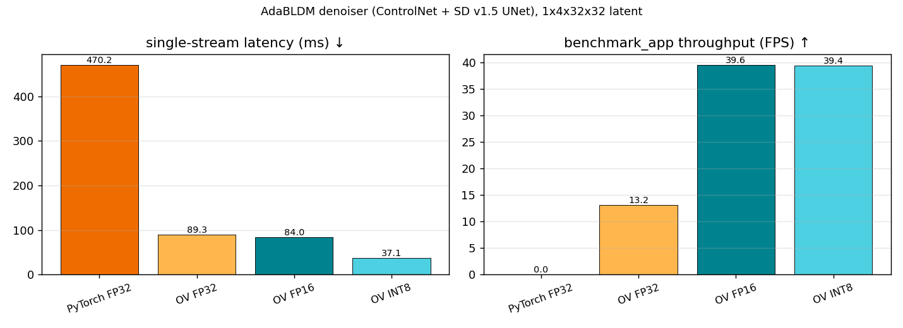

# Convert and Optimize AdaBLDM (ControlNet + Stable-Diffusion UNet) defect generation with OpenVINO™

    

[AdaBLDM](https://github.com/GrandpaXun242/AdaBLDM) ([paper](https://arxiv.org/abs/2402.19330)) is a blended latent
diffusion model for **industrial defect generation**: a ControlNet branch conditions a Stable-Diffusion v1.5 UNet on a
"triple map" (object mask + defect mask) and a text prompt, so synthetic defects appear exactly where the mask says
they belong. Generated defect images help train and balance visual-inspection models when real defective samples are
rare. As in every ControlNet pipeline, the neural network is the fused **denoiser** (ControlNet + UNet); the DDIM
sampler and the triple-map assembly run on the host.

Because the upstream repository publishes no trained checkpoint, the notebook builds the AdaBLDM architecture and
initializes it from the public Stable-Diffusion v1.5 weights — the project's documented pretrain stage, identical to
what the upstream `tool_add_control.py` does. The compute graph, model size and latency are those of a fine-tuned
AdaBLDM; only the weight values differ.

## Notebook Contents

The [ada-bldm.ipynb](ada-bldm.ipynb) notebook is self-contained — it clones the AdaBLDM repository, downloads the
public Stable-Diffusion v1.5 checkpoint and builds the PyTorch FP32 denoiser — and follows these steps:

- Install prerequisites
- Clone AdaBLDM, download the base checkpoint and build the PyTorch FP32 denoiser (ControlNet + UNet fused into one graph)
- Convert the denoiser to OpenVINO FP32 and FP16 IR with static shapes
- Validate the converted models against PyTorch (output cosine similarity)
- Run a 20-step DDIM generation loop on the converted model and decode the result with the Stable-Diffusion VAE
- Optimize the denoiser to INT8 with NNCF Post-training Quantization
- Compare latency and throughput of all precisions with `benchmark_app`

[adabldm_nb_utils.py](adabldm_nb_utils.py) contains the model builder, the Stable-Diffusion v1.5 initialization, the
host-side sampler helpers and the benchmark parsing.

## Installation Instructions

We recommend running the notebook in a virtual environment. You only need a Jupyter server to start. For details,
please refer to the [Installation Guide](https://github.com/openvinotoolkit/openvino_notebooks/blob/latest/README.md).

The AdaBLDM source clone and the Stable-Diffusion v1.5 checkpoint (`v1-5-pruned-emaonly.ckpt`, ~4 GiB) are downloaded
automatically on first run; set `ADABLDM_BASE_CKPT` to reuse a local copy. The CLIP text encoder
(`openai/clip-vit-large-patch14`) is fetched from Hugging Face Hub.

## Licenses

- The [AdaBLDM repository](https://github.com/GrandpaXun242/AdaBLDM) does not publish a license file; the clone is used
  only to build the model architecture.
- The Stable-Diffusion v1.5 base checkpoint is released under the **CreativeML OpenRAIL-M** license.
- The CLIP text encoder (`openai/clip-vit-large-patch14`) is released under the **MIT** license.

