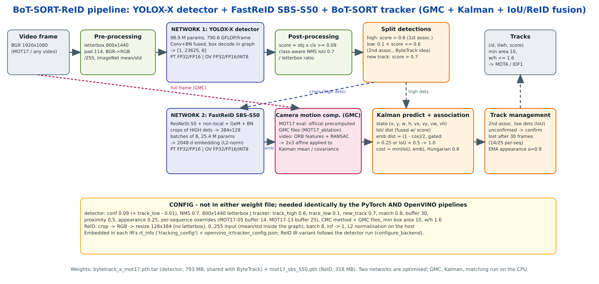

# BoT-SORT multi-object tracking with OpenVINO

[BoT-SORT](https://github.com/NirAharon/BoT-SORT) uses a YOLOX-X person
detector (`bytetrack_x_mot17.pth.tar`, `1×3×800×1440`) and a FastReID SBS-S50
appearance model (`mot17_sbs_S50.pth`, batches of `8×3×384×128`).
The tracker (camera-motion compensation, Kalman filtering, IoU and appearance
association) runs on the host. Tracking thresholds and MOT17 per-sequence
overrides are kept in the configuration, separate from network weights and IRs.

## Model architecture

[Open the animated architecture diagram](./botsort_pipeline_animated.svg)
to follow the detector, appearance and motion branches. This original project
drawing also labels INT8 experiments; this tutorial exports **FP32, FP16
and INT8**.

| Stage | Execution | Role |
|---|---|---|
| Frame preparation and YOLOX-X | Host preprocessing, OpenVINO network | Letterbox each frame to `800×1440`; decode person boxes in the detector graph and filter/NMS detections on the host. The detector uses the same MOT17 checkpoint as ByteTrack. |
| FastReID SBS-S50 | Host crops, OpenVINO network | Crop detected people into batches of eight `384×128` RGB images. The network produces 2048-dimensional appearance features, which are normalized for matching. |
| Camera-motion compensation | Host | Estimate camera motion (precomputed GMC for MOT17, ORB for the video) and correct Kalman track predictions. |
| BoT-SORT association | Host | Combine predicted motion, IoU and ReID similarity to associate high-score detections; a second association considers lower-score boxes. Maintain track IDs, lost tracks and new tracks. |

**Model assets:** `bytetrack_x_mot17.pth.tar` holds the YOLOX-X detector
weights; `mot17_sbs_S50.pth` holds the FastReID appearance-network weights.
The notebook exports **both** networks as FP32, FP16 and INT8 `.xml`/`.bin` IRs.
GMC, matching logic and thresholds are not learned network weights: the
tracking configuration is saved alongside and embedded in the IRs.

## Tutorial

The [tutorial](bot-sort.ipynb) converts both networks to OpenVINO FP32 and FP16
IR, quantizes them to INT8 with NNCF, checks accuracy and ReID fidelity,
benchmarks each precision with `benchmark_app`-style runs and tracks a video
at FP32, FP16 and INT8. The executed notebook keeps its cell outputs, contact
sheets and the embedded playable video previews.
[botsort_nb_utils.py](botsort_nb_utils.py) contains the host-side tracker,
ReID crops, preprocessing and evaluation.

## Installation Instructions and data

Run the tutorial **from this folder**. Install the Python packages the
notebook imports (OpenVINO, NNCF, PyTorch, OpenCV, motmetrics, lap, yacs,
ipywidgets, matplotlib) and provide the BoT-SORT source clone and the two
official checkpoints (`bytetrack_x_mot17.pth.tar`, `mot17_sbs_S50.pth`).
The notebook was written against a project layout that also holds the PyTorch
baseline artifacts (`artifacts/`) produced by its companion PyTorch notebook,
so a fresh clone cannot re-run it end to end without them. The saved outputs
show a complete run.

The bundled [JK_Standing_Next2U.mp4](JK_Standing_Next2U.mp4) is the first
**30 seconds (900 frames at 30 FPS)** of the demonstration video, re-encoded
at 1920x1080.

MOT17 is not redistributed here. Provide the MOT17 FRCNN train sequences
for the accuracy sections.

