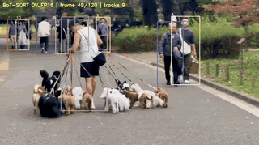

# Convert and Optimize BoT-SORT multi-object tracking with OpenVINO™

    

[BoT-SORT](https://github.com/NirAharon/BoT-SORT) ([paper](https://arxiv.org/abs/2206.14651)) is a state-of-the-art
multi-object tracking pipeline built from **two neural networks** plus a host-side tracker: a YOLOX-X person detector
(`bytetrack_x_mot17`, `1×3×800×1440`), a FastReID SBS-S50 appearance network (`mot17_sbs_S50`, batches of
`8×3×384×128`), and camera-motion compensation, Kalman filtering and IoU/appearance association running on the host.
OpenVINO replaces both networks; the tracking thresholds and per-sequence overrides live in a configuration that is
embedded into the IRs' `rt_info` and saved next to them.

## Notebook Contents

The [bot-sort.ipynb](bot-sort.ipynb) notebook is self-contained — it clones the BoT-SORT repository, downloads the two
official checkpoints and builds the PyTorch FP32 models — and follows these steps:

- Install prerequisites
- Clone BoT-SORT, download checkpoints and build the PyTorch FP32 models
- Convert both networks to OpenVINO FP32 and FP16 IR
- Validate the converted models against PyTorch (detector and ReID parity)
- Track a video and score every precision against PyTorch FP32 reference tracks
- Optimize both networks to INT8 with NNCF (with accuracy control when needed)
- Compare accuracy (MOTA / IDF1 on optional MOT17) and latency of all precisions

[botsort_nb_utils.py](botsort_nb_utils.py) contains the host-side tracker, pre/post-processing, ReID crops and
evaluation helpers.

## Installation Instructions

We recommend running the notebook in a virtual environment. You only need a Jupyter server to start. For details,
please refer to the [Installation Guide](https://github.com/openvinotoolkit/openvino_notebooks/blob/latest/README.md).

The BoT-SORT source clone and the two official checkpoints (`bytetrack_x_mot17.pth.tar`, `mot17_sbs_S50.pth`) are
downloaded automatically on first run; set `BOTSORT_REPO`, `BOTSORT_DET_WEIGHTS` or `BOTSORT_REID_WEIGHTS` to reuse
local copies.

The sample video is downloaded at runtime from Wikimedia Commons:
["Pro dog walker - Tokyo - 2024 Nov 1"](https://commons.wikimedia.org/wiki/File:Pro_dog_walker_-_Tokyo_-_2024_Nov_1.webm)
by User:Nesnad, licensed **CC BY-SA 4.0**. The MOT17 dataset is **optional** and not redistributed here — provide the
MOT17 FRCNN train sequences (set `MOT17_TRAIN`) to enable the MOTA / IDF1 accuracy sections; the video demo,
quantization and benchmarks run without it. Tracking output videos are written to a local `artifacts/video/` folder.

