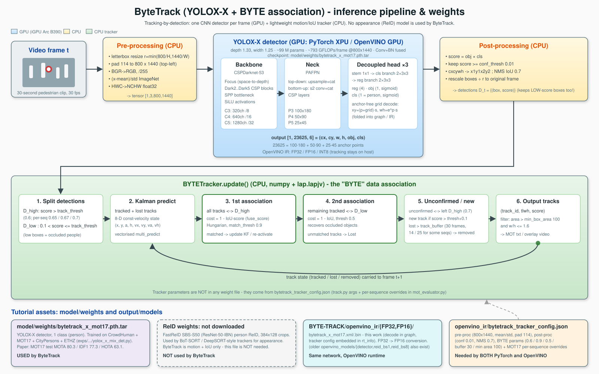

# ByteTrack multi-object tracking with OpenVINO

[ByteTrack](https://github.com/FoundationVision/ByteTrack) combines a YOLOX-X
person detector (MOT17 checkpoint `bytetrack_x_mot17.pth.tar`, input
`1×3×800×1440`) with a host-side BYTETracker. Detection decoding is included
in the exported network; filtering, association, Kalman filtering and
per-sequence tracking thresholds are **not** in the weights or the IR. The
tracker settings accompany the IR as `bytetrack_config.json` and model metadata.

## Model architecture

[Open the animated architecture diagram](./bytetrack_pipeline_animated.svg)
to see the per-frame flow and the track-state feedback loop. The drawing was
made for the broader ByteTrack study, so the asset paths illustrated there
are examples rather than additional tutorial requirements.

| Stage | Execution | Role |
|---|---|---|
| Image preparation | Host | Resize and letterbox a video/MOT17 frame to `800×1440`, retaining the scale factor needed to map boxes back to the original frame. |
| YOLOX-X | PyTorch for export; OpenVINO for inference | Run the single-class person detector. Anchor-free grid decoding is folded into the network; output boxes, objectness and class scores feed the tracker. |
| Detection filtering | Host | Apply confidence filtering and non-maximum suppression (NMS); restore image coordinates. |
| BYTETracker | Host | Predict existing tracks with a Kalman filter, associate high-confidence detections first and then low-confidence detections by IoU/Hungarian matching. Create, retain or retire track IDs according to the tracker thresholds and buffer. |

**Model assets:** `bytetrack_x_mot17.pth.tar` contains the YOLOX-X detector
weights; it does not contain BYTETracker parameters. The tutorial creates
FP32, then FP16 and NNCF INT8 OpenVINO `.xml`/`.bin` detector IRs. It stores
`bytetrack_config.json` alongside each IR and embeds the same configuration
in the IR metadata. There is **no ReID network** in ByteTrack.

## Tutorial

The [tutorial](byte-track.ipynb) starts with the original PyTorch
checkpoint, converts it to OpenVINO FP32 and FP16 IR, calibrates INT8 from
32 spaced frames of the bundled video, checks inference against the PyTorch
source, can measure MOT17 val-half MOTA/IDF1 and tracks a video at each precision.
[bytetrack_nb_utils.py](bytetrack_nb_utils.py) contains the host-side
pre/postprocessing, tracker and evaluation shared by all three OpenVINO precisions.
There is no separate PyTorch notebook or benchmark script in this folder.

## Installation Instructions and data

Run the tutorial **from this folder**. Its first code cell installs Python
dependencies using `%pip`. On first use, the notebook clones the public
ByteTrack source and downloads its official MOT17 detector checkpoint into
the ignored `model/` directory. The tracker configuration is included in
[bytetrack_tracker_config.json](bytetrack_tracker_config.json). Generated
OpenVINO IRs and results go to the ignored `output/` directory.

The [bundled video](pedestrians_cc0_30s.mp4) contains exactly **30 seconds
(900 frames at 30 FPS)**. All three OpenVINO variants track at most those 900
frames at **FP32, FP16 and INT8**; a playable annotated MP4 and a contact sheet
are saved under `output/results/video/` for each precision. The contact sheets
and embedded playable videos remain visible in the executed notebook. GPU FP32 explicitly
requests `f32` execution. Video calibration is a self-contained INT8
demonstration, not a substitute for independent MOT17 accuracy measurement.
To change the inference device, edit the dropdown's `value` in the notebook's
device-selection cell. Saved cell outputs use plain text rather than widget views,
so results remain readable in viewers without Jupyter widget support.

MOT17 is not redistributed here. To run the optional accuracy section,
provide the MOT17 FRCNN train sequences in `data/MOT17/train/` and set
`RUN_MOT17_ACCURACY = True` in the notebook.

**Video license:** The bundled excerpt is derived from
[DiagonalCrosswalkYongeDundas.webm](https://commons.wikimedia.org/wiki/File:DiagonalCrosswalkYongeDundas.webm)
by Raysonho @ Open Grid Scheduler / Grid Engine (own work, [CC0 1.0](https://creativecommons.org/publicdomain/zero/1.0/)).
It was resized, encoded to H.264 and limited to 900 frames at 30 FPS, with the
audio removed. This public-domain pedestrian scene is used instead of the
unlicensed local demonstration video.

