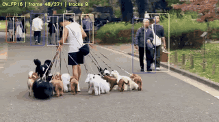

# Convert and Optimize ByteTrack (YOLOX-X + BYTETracker) multi-object tracking with OpenVINO™

    

[ByteTrack](https://github.com/FoundationVision/ByteTrack) ([paper](https://arxiv.org/abs/2004.01888)) is a
tracking-by-detection pipeline built from **one neural network** plus a host-side tracker: a YOLOX-X person detector
(`bytetrack_x_mot17`, `1×3×800×1440`) and a BYTETracker that associates detections over time with Kalman filtering and
IoU matching — high-score boxes first, then low-score boxes to recover occluded objects. There is **no ReID network**.
OpenVINO replaces the detector; the tracking thresholds and per-sequence overrides live in a configuration that is
embedded into the IRs' `rt_info` and saved next to them.

## Notebook Contents

The [byte-track.ipynb](byte-track.ipynb) notebook is self-contained — it clones the ByteTrack repository, downloads
the official MOT17 checkpoint and builds the PyTorch FP32 detector with the box decode folded into the graph — and
follows these steps:

- Install prerequisites
- Clone ByteTrack, download the checkpoint and build the PyTorch FP32 detector
- Convert the detector to OpenVINO FP32 and FP16 IR
- Validate the converted models against PyTorch (single-frame parity)
- Track a video and score every precision against PyTorch FP32 reference tracks
- Optimize the detector to INT8 with NNCF (with accuracy control when needed)
- Compare accuracy (MOTA / IDF1 on optional MOT17) and latency of all precisions

[bytetrack_nb_utils.py](bytetrack_nb_utils.py) and [bt_common.py](bt_common.py) contain the host-side
pre/post-processing, tracker and evaluation helpers; [bytetrack_tracker_config.json](bytetrack_tracker_config.json)
holds the tracking configuration that is not in the weights.

## Installation Instructions

We recommend running the notebook in a virtual environment. You only need a Jupyter server to start. For details,
please refer to the [Installation Guide](https://github.com/openvinotoolkit/openvino_notebooks/blob/latest/README.md).

The ByteTrack source clone and the official checkpoint (`bytetrack_x_mot17.pth.tar`) are downloaded automatically on
first run; set `BYTETRACK_WEIGHTS` to reuse a local copy.

The sample video is downloaded at runtime from Wikimedia Commons:
["Pro dog walker - Tokyo - 2024 Nov 1"](https://commons.wikimedia.org/wiki/File:Pro_dog_walker_-_Tokyo_-_2024_Nov_1.webm)
by User:Nesnad, licensed **CC BY-SA 4.0**. The MOT17 dataset is **optional** and not redistributed here — provide the
MOT17 FRCNN train sequences (set `MOT17_TRAIN`) to enable the MOTA / IDF1 accuracy sections; the video demo,
quantization and benchmarks run without it. Tracking output videos are written to a local `results/video/` folder.

