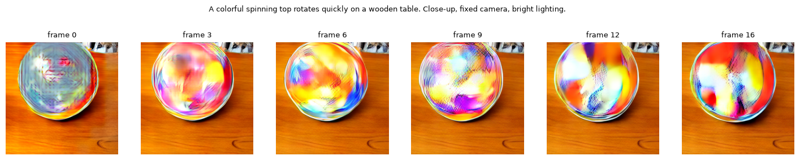

# Text-to-Video Generation with Cosmos3-Edge and OpenVINO

[Cosmos3-Edge](https://huggingface.co/nvidia/Cosmos3-Edge) is the smallest model of NVIDIA's [Cosmos 3](https://research.nvidia.com/labs/cosmos-lab/cosmos3/) family of omnimodal world models for Physical AI ([technical report](https://research.nvidia.com/labs/cosmos-lab/cosmos3/technical-report.pdf)). It is a Mixture-of-Transformers: an autoregressive text tower reads the prompt, and a diffusion tower that attends to it denoises video latents, which a Wan VAE decodes into frames.

## Notebook Contents

The tutorial generates 17-frame, 256×256 videos from a text prompt and consists of the following steps:

1. **Download the model** - Download the text tokenizer, transformer, VAE and scheduler configuration of the public [checkpoint](https://huggingface.co/nvidia/Cosmos3-Edge) from Hugging Face.
2. **Load the PyTorch model** - Rebuild the text tower and all denoising steps as one static-shape PyTorch module (`cosmos3_edge_helper.py`) and run a reference generation.
3. **Convert the models to OpenVINO IR** - Convert the generator and the VAE decoder with static input shapes, then apply graph optimizations for GPU and a mixed INT8 VAE decoder.
4. **Run OpenVINO inference** - Generate a video from a prompt on the selected device and save it as an MP4.
5. **Verify the conversion** - Compare the OpenVINO generator, decoder and full video with the PyTorch reference.

The Cosmos3-Edge model is released under the [OpenMDW 1.1](https://openmdw.ai/license/1-1/) license.

## Installation Instructions

This is a self-contained example that relies solely on its own code. 
We recommend running the notebook in a virtual environment. You only need a Jupyter server to start.
For details, please refer to [Installation Guide](../../README.md).

