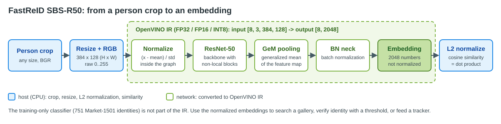

# Convert and Optimize FastReID person re-identification with OpenVINO™

    

Person re-identification (ReID) answers the question "have I seen this person before?". A ReID network turns a cropped
image of a person into a vector of numbers, an *embedding*, so that crops of the same person are close together (high
cosine similarity) and crops of different people are far apart. Embeddings are used to search a gallery of people
across cameras and to keep object IDs stable in multi-object trackers such as [BoT-SORT](https://github.com/NirAharon/BoT-SORT).

[FastReID](https://github.com/JDAI-CV/fast-reid) ([paper](https://arxiv.org/abs/2006.12056)) is an open-source ReID
toolbox. This tutorial converts one FastReID model, **SBS-R50** trained on
[Market-1501](https://zheng-lab.cecs.anu.edu.au/Project/project_reid.html) (`configs/Market1501/sbs_R50.yml`,
checkpoint `market_sbs_R50.pth` from the FastReID model zoo), to OpenVINO IR and optimizes it with NNCF. The model is
a ResNet-50 backbone with non-local blocks, generalized-mean (GeM) pooling and a batch-normalization neck; it takes
`8×3×384×128` person crops (RGB, raw `0..255` — the network normalizes them itself) and returns `8×2048` embeddings
that must be L2-normalized before cosine similarity.

## Notebook Contents

The [fast-reid.ipynb](fast-reid.ipynb) notebook is self-contained — it downloads the FastReID code and the
Market-1501 SBS-R50 checkpoint on first run — and follows these steps:

- Install prerequisites
- Download the FastReID code and checkpoint and build the PyTorch model
- Run the PyTorch model on public sample crops and use the embeddings for retrieval
- Convert the model to OpenVINO FP32 and FP16 IR and verify it against PyTorch
- Optimize the model to INT8 with NNCF post-training quantization
- Compare the latency and throughput of all precisions with `benchmark_app`

## Installation Instructions

We recommend running the notebook in a virtual environment. You only need a Jupyter server to start. For details,
please refer to the [Installation Guide](https://github.com/openvinotoolkit/openvino_notebooks/blob/latest/README.md).

The FastReID code, the sample crops (`tools/deploy/test_data`) and the checkpoint are downloaded automatically on
first run; nothing from them is stored in this repository. The notebook is pinned to FastReID commit `c9bc3ce`.

Market-1501 and MOT17 are **optional** and not redistributed here: set `REID_DATA` to a MOT17 `train` folder (rank-1 /
mAP accuracy and INT8 calibration on real crops) or to a Market-1501 folder (INT8 calibration only). Without them,
INT8 is calibrated on augmented copies of the sample crops, which lets the notebook run end to end but makes its INT8
accuracy numbers not meaningful.

### Licenses

- FastReID code and model zoo: [Apache License 2.0](https://github.com/JDAI-CV/fast-reid/blob/master/LICENSE).
- Market-1501 (training data of the checkpoint, source of the five sample crops): released for research use; check
  its terms before any commercial use.
- MOT17 (optional, supplied by you): [CC BY-NC-SA 3.0](https://motchallenge.net/data/MOT17/), non-commercial.

The notebook works on cropped images of whole bodies and does not perform face recognition or analyze demographics.

