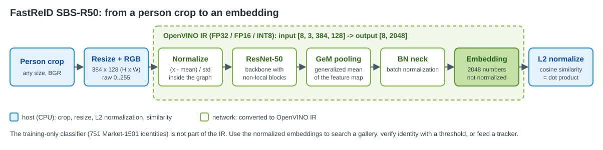

# Convert and Optimize FastReID person re-identification with OpenVINO™

[FastReID](https://github.com/JDAI-CV/fast-reid) is an open-source toolbox for person re-identification (ReID) and other retrieval tasks. A ReID network turns a cropped image of a person into a vector of numbers, an *embedding*, so that crops of the same person are close together (high cosine similarity) and crops of different people are far apart. Embeddings are used to search a gallery of people across cameras and to keep object IDs stable in multi-object trackers such as [BoT-SORT](https://github.com/NirAharon/BoT-SORT).

This tutorial converts one FastReID model, **SBS-R50** trained on [Market-1501](https://zheng-lab.cecs.anu.edu.au/Project/project_reid.html) (`configs/Market1501/sbs_R50.yml`, checkpoint `market_sbs_R50.pth` from the FastReID model zoo), to OpenVINO IR and optimizes it with NNCF.

## Model architecture

    

The model is a ResNet-50 backbone with non-local blocks, followed by generalized-mean (GeM) pooling and a batch-normalization neck. The network normalizes its input itself and has a fixed batch size of 8 crops in the IR:

| | Shape | Notes |
|---|---|---|
| Input | `[8, 3, 384, 128]` | person crops, NCHW, RGB, raw `0..255` (do **not** normalize again), height 384, width 128 |
| Output | `[8, 2048]` | embeddings, **not** L2-normalized; normalize them before cosine similarity |

The embeddings describe appearance (clothing color, texture, body shape), not identity: the same person in different clothes may score low, and two people in the same outfit may score high. The training-only classifier head of the checkpoint is not part of the IR.

## Notebook Contents

This folder contains a notebook that shows how to convert and optimize the model with OpenVINO. The tutorial consists of the following parts:

1. Download the FastReID code and the Market-1501 SBS-R50 checkpoint, and check that every checkpoint key loads.
2. Run the PyTorch model on five public sample crops and use the embeddings for retrieval.
3. Convert the PyTorch model to OpenVINO IR (FP32, then FP16) and verify it against PyTorch.
4. Optimize the model with INT8 post-training quantization using NNCF.
5. Compare the performance of the FP32, FP16 and INT8 models with `benchmark_app`.

## Data and models

The FastReID code, the five sample crops (`tools/deploy/test_data`) and the checkpoint are downloaded from the [FastReID repository](https://github.com/JDAI-CV/fast-reid) when the notebook runs; nothing from it is stored here. The notebook is pinned to commit `c9bc3ce`. Market-1501 and MOT17 cannot be downloaded automatically: set `REID_DATA` in the quantization section to a MOT17 `train` folder or a Market-1501 folder to calibrate INT8 on real crops (and, with MOT17, to measure rank-1 and mAP). Without it, INT8 is calibrated on augmented copies of the sample crops, which lets the notebook run end to end but makes its INT8 accuracy not meaningful.

### Licenses

- FastReID code and model zoo: [Apache License 2.0](https://github.com/JDAI-CV/fast-reid/blob/master/LICENSE).
- Market-1501 (training data of the checkpoint, source of the five sample crops): released for research use; check its terms before any commercial use.
- MOT17 (optional, supplied by you): [CC BY-NC-SA 3.0](https://motchallenge.net/data/MOT17/), non-commercial.

The notebook works on cropped images of whole bodies and does not perform face recognition or analyze demographics.

## Installation Instructions

This is a self-contained example that relies solely on its own code. 
We recommend running the notebook in a virtual environment. You only need a Jupyter server to start.
For details, please refer to [Installation Guide](../../README.md).

