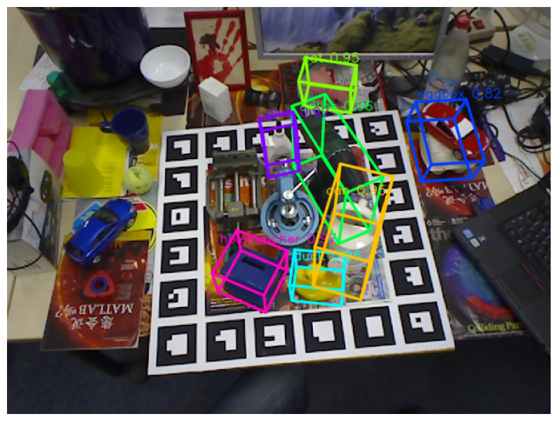

# 6D Object Pose Estimation with GDRNPP and OpenVINO

[GDRNPP](https://github.com/shanice-l/gdrnpp_bop2022) (Geometry-Guided Direct Regression Network++, [paper](https://arxiv.org/abs/2102.12145)) estimates the 6D pose, meaning the 3D rotation and translation, of known objects from a single RGB image. It won most awards of the [BOP Challenge 2022](https://bop.felk.cvut.cz/challenges/bop-challenge-2022/). A YOLOX detector finds each object, then the GDRN network predicts dense 2D-3D correspondences for every detection and recovers its pose.

## Notebook Contents

The tutorial uses the models trained on the Linemod-Occluded (LM-O) dataset and consists of the following steps:

1. **Download checkpoints and sample data** - Download the released YOLOX-X and GDRN checkpoints from [ModelScope](https://www.modelscope.cn/models/wangg12/GDRNPP) and one LM-O test image from the [BOP benchmark](https://huggingface.co/datasets/bop-benchmark/lmo).
2. **Load the PyTorch models** - Rebuild both networks in plain PyTorch (`gdrnpp_helper.py`) and run a reference inference.
3. **Convert the models to OpenVINO IR** - Convert both models with static input shapes so they run on CPU, GPU and NPU.
4. **Run OpenVINO inference** - Estimate the pose of every detected object on the selected device and draw the projected 3D bounding boxes.
5. **Verify the conversion** - Compare OpenVINO outputs with PyTorch and the estimated poses with the LM-O ground truth.

The GDRNPP and YOLOX model code is licensed under Apache 2.0.

## Installation Instructions

This is a self-contained example that relies solely on its own code. 
We recommend running the notebook in a virtual environment. You only need a Jupyter server to start.
For details, please refer to [Installation Guide](../../README.md).

